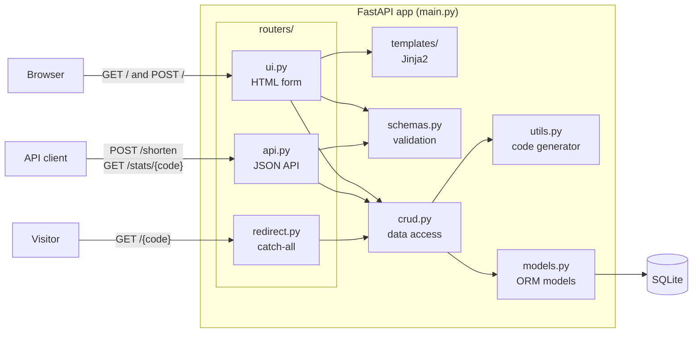
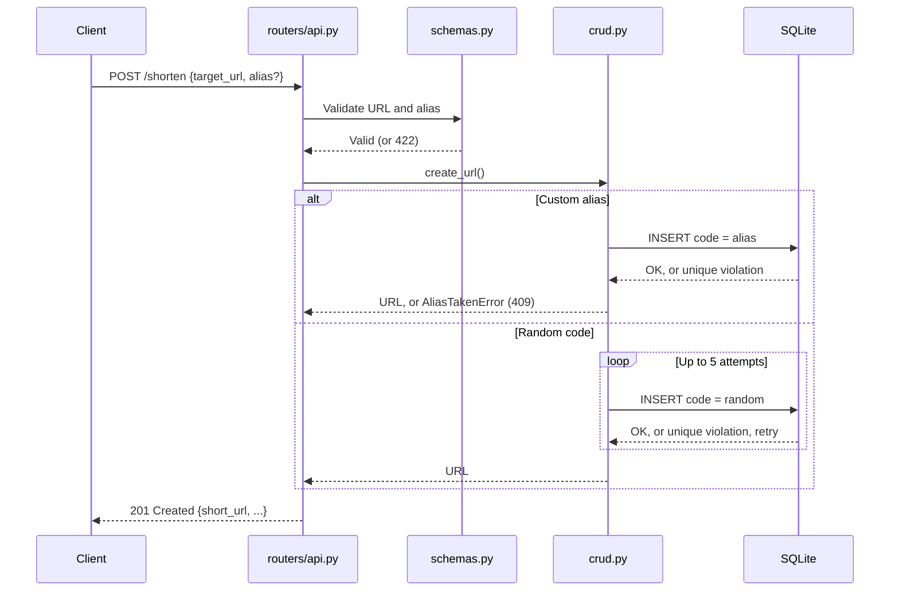
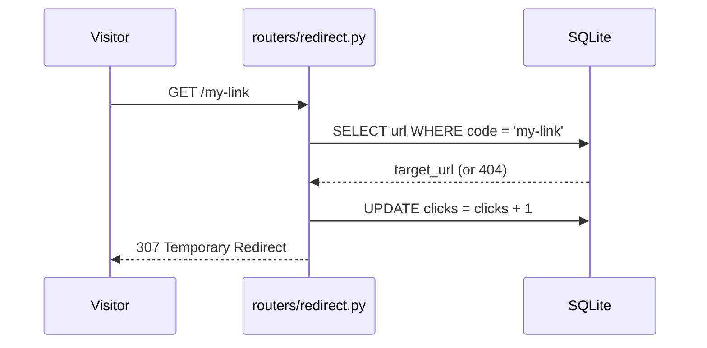

# URL Shortener

A small, production-minded URL shortener built with **FastAPI**, **SQLAlchemy 2.0** and **Pydantic v2**. It exposes a JSON API and a server-rendered HTML form, with random or custom short codes, click tracking, and a fully isolated test suite.

Built as a hands-on Python project, with an emphasis on clean layering, correctness under concurrency, and testability.

## Features

- Shorten any valid URL to a random 7-character base62 code
- Optional custom aliases (`/my-link`) with validation and reserved-word protection
- Click tracking with an atomic counter
- Stats endpoint per short link
- HTML form UI with copy-to-clipboard
- Interactive API docs at `/docs` (generated by FastAPI)
- Test suite running against an in-memory database, with no setup needed

## Tech stack

| Layer | Tool |
|---|---|
| Web framework | FastAPI |
| Validation | Pydantic v2, pydantic-settings |
| Database | SQLite via SQLAlchemy 2.0 (typed ORM) |
| Templates | Jinja2 |
| Server | Uvicorn |
| Testing | pytest, FastAPI TestClient |

## Architecture

The app is split into layers, each with one job. `main.py` only wires things together. Routes are grouped into three routers by concern, schemas validate input and shape output, and the data-access layer talks to the database without knowing anything about HTTP.



Routers are registered in a fixed order in `main.py`: `ui`, then `api`, then `redirect`. The redirect router's `GET /{code}` matches any single path segment, so it must come last or it would swallow routes registered after it.

### Creating a short link



The HTML form follows the same path through `routers/ui.py`, reusing the same schema and `create_url()`, and renders the result into the template instead of returning JSON.

### Following a short link



## Project structure

```
url-shortener/
├── app/
│   ├── main.py          # App setup: lifespan and router registration
│   ├── routers/
│   │   ├── api.py       # JSON API: /shorten, /stats/{code}
│   │   ├── ui.py        # HTML form: GET and POST /
│   │   └── redirect.py  # GET /{code} catch-all (registered last)
│   ├── config.py        # Settings from environment / .env
│   ├── database.py      # Engine, session factory, get_db dependency
│   ├── models.py        # SQLAlchemy ORM models
│   ├── schemas.py       # Pydantic request/response models
│   ├── crud.py          # Data access, no HTTP concerns
│   ├── utils.py         # Short-code generation
│   └── templates/
│       └── index.html   # HTML form UI
├── tests/
│   ├── conftest.py      # In-memory test DB and client fixture
│   ├── test_api.py      # JSON API tests
│   ├── test_ui.py       # HTML form tests
│   └── test_utils.py    # Unit tests
├── requirements.txt
└── README.md
```

## Getting started

Requires **Python 3.12+**.

```bash
git clone https://github.com/ashokgharpankar/url-shortener.git
cd url-shortener

python3.12 -m venv .venv
source .venv/bin/activate        # Windows: .venv\Scripts\activate
pip install -r requirements.txt

uvicorn app.main:app --reload
```

Then open:

- http://127.0.0.1:8000/ for the web UI
- http://127.0.0.1:8000/docs for interactive API docs (HTML routes are hidden from the docs)

### Configuration

Settings are read from environment variables or a `.env` file in the project root. All have defaults.

| Variable | Default | Description |
|---|---|---|
| `DATABASE_URL` | `sqlite:///./shortener.db` | SQLAlchemy database URL |
| `BASE_URL` | `http://localhost:8000` | Prefix used to build `short_url` |
| `CODE_LENGTH` | `7` | Length of random short codes |

## API

### Create a short link

```bash
curl -X POST http://127.0.0.1:8000/shorten \
  -H "Content-Type: application/json" \
  -d '{"target_url": "https://www.python.org", "alias": "py"}'
```

`alias` is optional. Response (`201 Created`):

```json
{
  "code": "py",
  "target_url": "https://www.python.org/",
  "short_url": "http://localhost:8000/py",
  "clicks": 0,
  "created_at": "2026-10-25T15:30:00Z"
}
```

| Status | Meaning |
|---|---|
| `201` | Created |
| `409` | Alias already in use |
| `422` | Invalid URL, or alias fails validation (3–32 chars, `A–Z a–z 0–9 - _`, not reserved) |

### Follow a short link

`GET /{code}` returns `307 Temporary Redirect` to the target URL and increments the click count, or `404` if the code doesn't exist.

### Get stats

`GET /stats/{code}` returns the same shape as the create response, with the current click count, or `404` if the code doesn't exist.

## Running tests

```bash
pytest -v
```

Tests use an in-memory SQLite database injected through FastAPI's dependency overrides, so they never touch `shortener.db` and need no setup. The suite covers the JSON API, the HTML form, validation rules, alias conflicts, click counting, and the collision-retry logic.

## Design decisions

- **`secrets`, not `random`, for codes.** `random` is predictable, which would let someone enumerate other users' links. Seven base62 characters give about 3.5 trillion combinations.
- **The database enforces uniqueness.** Codes are inserted directly and collisions are caught as `IntegrityError` and retried. Checking "does this code exist?" first would be a race condition between two concurrent requests.
- **Atomic click counter.** Clicks are incremented with `UPDATE ... SET clicks = clicks + 1` in SQL, not read-modify-write in Python, so concurrent visits are never lost.
- **307, not 301, redirects.** Browsers cache 301 permanently, which would bypass the server on repeat visits and make click counts wrong.
- **One router per concern.** API, UI and redirect routes live in separate modules, and `main.py` only registers them. The catch-all redirect is registered last, explicitly, so route order is visible in one place.
- **No HTTP in the data layer.** `crud.py` raises plain exceptions like `AliasTakenError`, and routers map them to status codes. The data layer stays reusable from a CLI or background job.
- **One set of validation rules.** The HTML form reuses the API's Pydantic schema, and both routers build responses with `URLInfo.from_model()`, so the UI and API can't drift apart.
- **Dependency injection for the database.** Routes get their session through `Depends(get_db)`, which lets tests swap in an in-memory database with one line.

## Roadmap

- [ ] Post/Redirect/Get on the form, so refreshing doesn't resubmit
- [ ] Link expiry (`410 Gone`)
- [ ] Return the existing code when the same URL is shortened twice
- [ ] GitHub Actions CI
- [ ] Dockerfile
- [ ] Rate limiting
- [ ] Alembic migrations
- [ ] Browser end-to-end tests with Playwright
